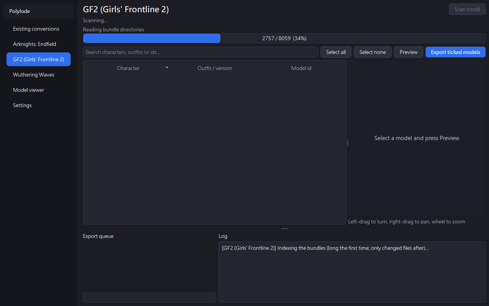
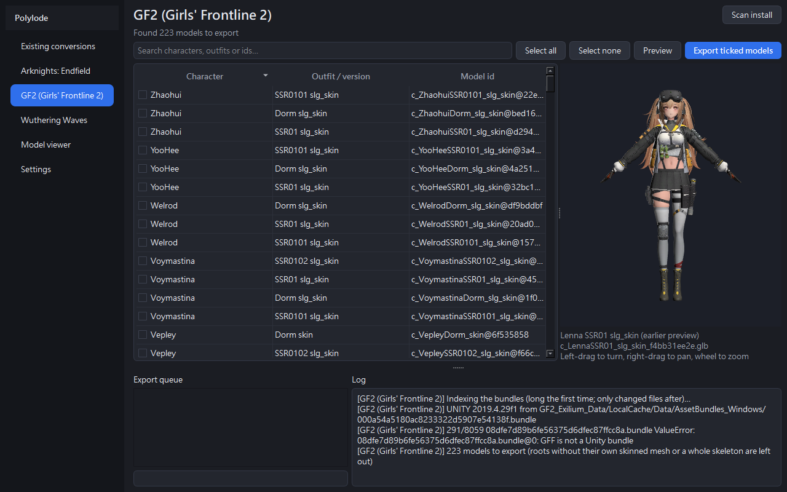
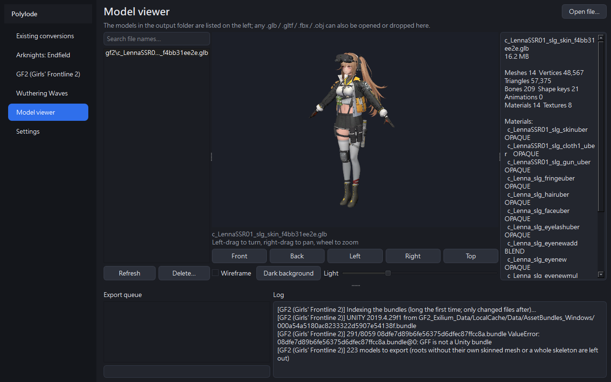
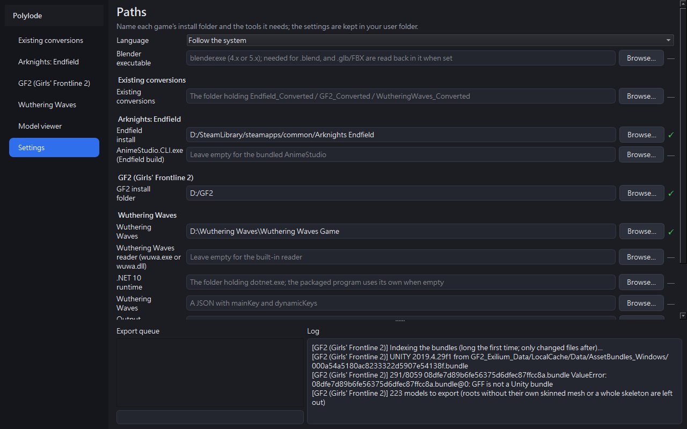

# Polylode

[English](../../README.md) · [繁體中文](README.zh-TW.md) · [简体中文](README.zh-CN.md) · **日本語** · [한국어](README.ko.md) · [Español](README.es.md) · [Français](README.fr.md) · [Deutsch](README.de.md)

**ステップごとの使い方（英語・繁体字中国語）：** [https://je-chen.github.io/Polylode/](https://je-chen.github.io/Polylode/)

Polylode はインストール済みのゲームからキャラクターモデルを掘り出し——鉱脈（*lode*）からポリゴン（*poly*gon）を——テクスチャとリグ付きの、
どこでも開けるファイルに書き出します：glTF（`.glb`）、FBX、Blender（`.blend`）。ウィンドウ、マウスで回せるプレビュー、モデルビューアを備えた
Windows デスクトッププログラムです。

| ゲーム | 読み取るもの | 備考 |
|---|---|---|
| アークナイツ：エンドフィールド | すべてのプレイアブルキャラクターのプレハブ | 初回スキャンでインストールから資産対応表を作成（分割検証・中断再開可）、ゲーム更新後に作り直し |
| ドールズフロントライン 2：エクシリウム | すべてのプレイアブルキャラクターの衣装 | 自身のスキンメッシュと完全な人型骨格を持つルートのみ（ペット・小物・空のバリアントは除外）。パーツを差し替えられる衣装は、ゲームが既定で着せる組み合わせで表示し、ほかの版と低い詳細レベルは FBX と .blend に非表示で残します（.glb は表示される部分のみ。Blender や多くのビューアは glTF の非表示指定を無視するため） |
| 鳴潮 | すべてのプレイアブルキャラクターの表示モデル | AES キーファイルが必要（`tools/wuwa_cli` からビルドした読み取りツールは同梱）。マテリアルの区画（髪、顔、上半身…）ごとに別パーツ |
| 既存の変換物 | `*_Converted` フォルダの完成モデル | 各ファイルの SHA-256 を確認してからコピー |

## スクリーンショット

英語表示のウィンドウを、`tools/screenshots.py` で実際にスキャン・プレビューしながら撮影したものです（ドールズフロントライン 2）。

| | |
|---|---|
|  |  |
| *スキャン：数えられる手順にはそれぞれ進捗バー* | *モデル一覧とプレビュー。モデル全体に合わせて表示* |
|  |  |
| *モデルビューアとファイルの内容* | *設定：インストールフォルダ、ツール、出力、言語* |

## 機能

- **スキャン、チェック、書き出し。** ゲームごとにページがあり、インストールをスキャンし、検索し、モデルをチェックしてキューで書き出します。
  スキャンと書き出しはそれぞれ別プロセスで動くため、変換の失敗がウィンドウを巻き込みません。
- **インストールを自動で探す。** スキャン前に Steam ライブラリで見つかったインストールを候補に出します。ゲームのフォルダ、その一つ上、データの中のどれを選んでも構いません。
- **三つの形式、うち二つは Blender 不要。** `.glb` と FBX は Polylode 自身が書き出します（骨格、スキンメッシュ、シェイプキー、埋め込みテクスチャ、透明）。
  `.blend` には Blender が必要です。Blender を指定すると、すべてのファイルを Blender で読み戻して確認します。
- **ゲームどおりのマテリアル。** カットアウト、半透明、アイシャドウのオーバーレイ、目のハイライト層を各ゲームのシェーダーから読んだ規則で書き出します。
  glTF／FBX で描けない層はその効果を下のテクスチャに焼き込み、`.blend` は本当の層のまま残します。鳴潮のカットアウトの被覆はゲーム自身のコンパイル済みシェーダーを実行して求め、視差の毛は毛束の層として作ります。エンドフィールドのエフェクト素材（翼、光）はゲームのコンパイル済みシェーダーで実行して焼き込み、発光マップは発光として書き出します。描けない素材は灰色にせず非表示にしてログに残します。
- **書き出し前のプレビュー。** 行を選んで「プレビュー」（またはダブルクリック）：モデルを `.glb` に変換してキャッシュに置き、一覧の横に表示します——
  左ドラッグで回転、右ドラッグで移動、ホイールで拡大縮小。プログラムやゲームファイルを更新したあとは「**再変換**」で作り直せます。
- **モデルビューア。** 出力フォルダのすべてのモデルを一覧し、任意の `.glb`・`.gltf`・`.fbx`・`.obj` を開けます（ドロップ、選択、または
  `Polylode.exe <ファイル>`。「プログラムから開く」に設定可）。正面・背面・側面・上からの視点、ワイヤーフレーム、明暗の背景、ライトの強さ、glTF の内容。
  一覧のモデルはごみ箱へ削除できます。
- **GitHub Pages 経由で Discord に共有。** Discord は 3D モデルを表示できないため、モデルビューアーの **GitHub Pages で共有…** が
  表示中の `.glb` を自分の GitHub Pages サイトに、ブラウザーで回せるページとして書き込み、プッシュして URL をコピーします。
  Discord に貼るとモデルの画像付きカードとして表示されます。
- **五つの言語。** English、繁體中文、简体中文、日本語、한국어。既定はシステムに従い、「設定」で選ぶとすぐ切り替わります。

## ダウンロード

[Releases](https://github.com/JE-Chen/Polylode/releases) から最新の `Polylode-<バージョン>-windows-x64.zip` を取得し、任意の場所に展開して
`Polylode.exe` を実行します。必要なものはすべて同梱しています：AnimeStudio（エンドフィールド用）、鳴潮の読み取りツール、.NET 10 ランタイム、glTF インポーター、
GPU ドライバのないコンピュータ向けのソフトウェア OpenGL。

動作環境：Windows 10 または 11（64 ビット）。`.blend` にのみ Blender 4.x または 5.x が必要です。

## 使用ガイド

### 1. 初回起動

リリースを任意の場所に展開し、`Polylode.exe` を実行します。表示は Windows の言語に従い、「**設定 → 言語**」で選ぶとすぐ切り替わります。
設定は入力した時点で保存され、すべてのキャッシュと一緒に `%LOCALAPPDATA%\Polylode` にあります。IslandLife の一部だった頃の
書き出しツールを使っていた場合、初回起動時にその設定、エンドフィールドの資産対応表、GF2 の索引とストアを移すので、作り直しは不要です。

### 2. 設定

- **出力フォルダ**——書き出し先。モデルごとにフォルダを作ります：`<出力>\<ゲーム>\<モデル ID>\`。
- **書き出し形式**——`.glb`、FBX、`.blend`。複数選べます。
- **Blender 実行ファイル**——任意。`.blend` にだけ必要です。指定すると `.glb` と FBX もすべて Blender で読み戻して確認します。
- **インストールフォルダ**——空欄で構いません。スキャン時に一つずつ尋ね、Steam ライブラリで見つかったものも候補に出します。
  ゲームのフォルダ、その一つ上、データの中のどれでも構いません。存在するパスには ✓ が付きます。
- **ツール**——空欄なら同梱のものを使います：AnimeStudio（エンドフィールド）、鳴潮の読み取りツール、.NET ランタイム。鳴潮には
  さらに **AES キーファイル**（お使いのバージョンの `mainKey` と `dynamicKeys` を含む JSON）が必要です。ファイルは暗号化されて
  おり、キーはあなた自身のもので、プログラムに同梱できません。最初のプレビューか書き出しの前に、プログラムの横、データフォルダ、インストールフォルダとその一つ上、ダウンロード、ドキュメント、デスクトップから手元のキーファイルを探し、見つからないときだけ尋ねます。

### 3. スキャン

ゲームのページを開いて「**インストールをスキャン**」を押します。ステータス行の下のバーが現在の手順を示し、数えられる手順は進捗を
表示します。初回スキャンにかかる時間：

- **アークナイツ：エンドフィールド**はインストールから資産対応表を作ります（数十分、分割して実行）。途中でプログラムを閉じても
  無駄にならず、次のスキャンが続きから進めます。
- **ドールズフロントライン 2**は bundle の索引を作り（数分）、どのルートがキャラクターモデルかを確認します。
- **鳴潮**はアーカイブからキャラクター表を読み込みます。

以降のスキャンはゲームが更新されるまで再利用します。更新後はもう一度スキャンしてください。GF2 のインストールがスキャン後に
変わった場合は、プレビューや書き出しがそう知らせます。

### 4. プレビュー

行を選び——検索欄でキャラクター、衣装、ID を絞り込めます——「**プレビュー**」を押すかダブルクリックします。モデルの初回
プレビューでは先に変換します（数秒〜1 分、専用の進捗バー付き）。以降はその行を選ぶとキャッシュからすぐ表示します。表示内では
**左ドラッグ**で回転、**右ドラッグ**で移動、**ホイール**で拡大縮小。読み込むたびにモデル全体が中央に収まります。

プレビューは最初に作ったときのまま残ります。「**再変換**」は選んだ行を作り直し——Polylode やゲームの更新後に——新しいものが
できた時点でキャッシュを置き換えます。それまでは以前のものが残ります。

### 5. 書き出し

モデルにチェックを入れ（「**すべて選択**」「**すべて解除**」は検索で表示中の行だけが対象）、「**チェックしたモデルを書き出す**」を
押します。下のキューが一つずつ処理します：⏳ 待機、▶ 実行中、✓ 完了、✗ 失敗——理由は隣のログに出ます。キューの下のバーは
モデル数を、その下のバーは書き出し中のモデルの手順を示します。書き出し中にウィンドウを閉じようとすると確認します。

### 6. モデルビューア

出力フォルダのモデルを新しい順に一覧します。「**ファイルを開く…**」、ウィンドウへのドロップ、または `Polylode.exe <ファイル>`
（「プログラムから開く」に設定可）で、任意の `.glb`、`.gltf`、`.fbx`、`.obj` を表示できます。「**正面**」「**背面**」「**左**」
「**右**」「**上**」で向きを変え、「**ワイヤーフレーム**」、背景ボタン、「**ライト**」で表示を変えます。右のパネルは glTF の内容——
メッシュ、頂点、ボーン、シェイプキー、各マテリアルの合成方法——を一覧し、古い規則で書き出されたファイル（書き出し直すべきもの）に
印を付けます。「**削除…**」はモデルと同名のファイル、テクスチャフォルダをごみ箱へ移します。

### 7. GitHub Pages で共有（Discord 向け）

Discord は 3D モデルを表示できず、貼った `.glb` はただのダウンロードファイルです。Polylode はモデルを、自分の GitHub アカウントにある
GitHub Pages サイトの 1 ページとして共有します。ページはどのブラウザーでもモデルを回せ、URL は Discord でモデル画像付きのカードになります。
ほかに何もインストールは要りません（Git も clone も不要）。

1. モデルビューアーで `.glb` を開き、**GitHub Pages で共有…** を押します。モデルが公開される URL を示し、確認してから続けます。
2. 初回はブラウザーで GitHub のサインインページを開き、短いコード（コピー済み）を表示します。コードを入力して Polylode を承認してください。
   要求するのは `public_repo`（公開リポジトリの作成と書き込み）だけで、承認はこのコンピューターにだけ、Windows ユーザー用に暗号化して保存します。
   **設定 → GitHub アカウント → サインアウト** で削除でき、GitHub の Settings → Applications で取り消せます。
3. アカウントに公開リポジトリ `polylode-models` を作り（初回のみ）、`models/<名前>/`（モデル、プレビューと同じ描画の 1200×630 カード画像、ページ）
   とサイトのモデル一覧を 1 つのコミットでアップロードします。
4. URL はコピー済みです：`https://<アカウント>.github.io/polylode-models/models/<名前>/`。初回、このリポジトリの Pages がまだ有効でなければ、
   メッセージに **Pages 設定を開く** が出ます。**Deploy from a branch**、`main`、`/ (root)` を選んで Save（一度だけ）。
   （プログラムから有効にするにはすべての非公開リポジトリへのアクセス権が必要なため、要求しません。）
5. GitHub Pages の更新は通常 1〜2 分です。その後 Discord に貼ってください。

**ポーズ。** 終末地キャラクターの書き出した `.glb` には、キャラクター画面で取るポーズ（ゲームでループ再生される `ui` モーション。初回はインストールから
デコード、約 30 秒）が入ります。共有ページの **Pose** メニューで切り替えられ、カード画像は最初のポーズになります。**設定 → ポーズ** でオフにでき、
プレビューには含まれません。ドールズフロントライン2 の衣装には戦闘外で見せる待機ポーズ（宿舎・衣装・寝室・エンディング：ゲームがループ再生するクリップ）が入ります。
初回の書き出しでゲームのクリップに一度だけ名前の索引を作ります（数分）。鳴潮のキャラクターには、画面でループ再生するポーズ（`CommonAnim/UiAnim`：自分の骨格で、始まりと終わりが同じクリップ）が入ります。
このバージョンでビルドしたリーダーでデコードします（古いリーダーでは省かれます）。

すでに自分の Pages サイトがある場合は、**設定 → GitHub Pages サイトのフォルダー** にそのローカル clone を指定すると、共有はそこにコミットして Git でプッシュします。

共有できるのは `.glb` だけで、最大 100 MB（GitHub の 1 ファイル上限）です。同じモデルを再共有するとページが置き換わります。
共有したものは公開されます。モデルはゲームのものなので、共有してよいか確認してください。このプログラム自身のフォルダーはサイトにできません。

### トラブルシューティング

- **スキャン、プレビュー、書き出しの前に説明やファイル選択が開く**——変換に欠かせないツールが未設定で、探す場所にも見つかりませんでした。鳴潮なら AES キーファイルです。ダイアログが説明するので、キーファイルを選ぶか、キー（`0x` と 16 進数 64 桁）を貼り付けるとキーファイルとして保存します。どちらも以後は記憶されます。
- ログに **「…が設定されていません」「…がありません」**——「**設定**」でそのパスを直してください。
- **「このファイルの大きさを測れませんでした」**——ビューアがファイルの範囲を読めませんでした（FBX 7.5 のファイルなど）。視点は
  原点にあるので、ホイールで拡大縮小してください。
- **`.blend` が書き出されない**——「**設定**」で Blender 実行ファイルを指定してください。
- **共有時に「git push が失敗しました」** —— Git がサイトのリポジトリへプッシュできません。Git で GitHub にサインインし（例：Git Credential Manager）、
  そのフォルダーから自分でプッシュできるか確認してください。**「サイトのフォルダーの origin が GitHub リポジトリではありません」** —— フォルダーは GitHub リポジトリの clone である必要があります。
- **その他の失敗**——下のログにスキャンや書き出しが出力したすべての行が残っています。

## ソースからビルド

```powershell
python -m venv .venv
.venv\Scripts\python -m pip install -r requirements-dev.txt
.venv\Scripts\python -m polylode.extractor          # ソースからウィンドウを起動
.venv\Scripts\python -m pytest tests                # テスト
.venv\Scripts\python build.py --dotnet <dotnet フォルダ>   # dist\Polylode\Polylode.exe、続けてセルフテスト
```

ビルドは Nuitka でコンパイルし（C コンパイラが必要：Visual Studio のもの）、AnimeStudio、.NET 10 ランタイム（`--dotnet`、既定は `DOTNET_ROOT`）、
ソフトウェア OpenGL をプログラムの横に置き、`Polylode.exe --selftest` を実行します。すべての変換モジュール、プレビューの QML、実際の `.glb` を読み込み、
どれかが欠けていればビルドは失敗します。

同梱の鳴潮読み取りツールは `tools/wuwa_cli/build.ps1` でビルドし（その `README.md` を参照）、`--wuwa-reader` でビルドに渡します。ワークフローは両方を行います。`tools/screenshots.py` はウィンドウ自身のスキャンとプレビューで上のスクリーンショットを撮り直します。

## CI/CD

- **CI**（`.github/workflows/ci.yml`）——`main` と `dev` へのプッシュと PR のたびに、Windows でリント、テスト、セルフテストを実行。
- **Release**（`.github/workflows/release.yml`）——`main` へのプッシュのたびに、テスト、Nuitka ビルドとパッケージ版のセルフテストを行い、
  圧縮したプログラムを GitHub Release として公開。

開発は `dev`、`main` がリリース版です。

## 構成

```
polylode/extractor/      ウィンドウ、スキャン、ジョブ、プレビュー、ビューア、言語
polylode/endfield/       アークナイツ：エンドフィールド——資産対応表、変換、FBX シーン
polylode/gf2/            ドールズフロントライン 2——bundle、プレイアブル名簿、変換、目の層の焼き込み
polylode/wuthering_waves/  鳴潮——ロール表、表示モデルの組み立て
polylode/interchange/    glTF と FBX のライター（Blender 不要）
tools/                   Blender スクリプト、アイコン、FBX SDK 確認、鳴潮読み取りツールのソース、AnimeStudio
tests/                   pytest
docs/                    スクリーンショット、ツールの説明、構成、未完了の項目、README の翻訳
build.py, main.py        パッケージ版のプログラム
```

## ライセンスとコンテンツ

Polylode のコードは GNU LGPL 2.1（`LICENSE`）、同梱の AnimeStudio は MIT（`tools/AnimeStudio/LICENSE`）です。Polylode はゲームのコンテンツを含みません：
あなた自身のコンピュータにインストールされたファイルを変換し、書き出したものもそこに残ります。スクリーンショットのモデルは作者自身のインストールから変換したものです。所有しているゲームにのみ使い、その規約を守ってください。
